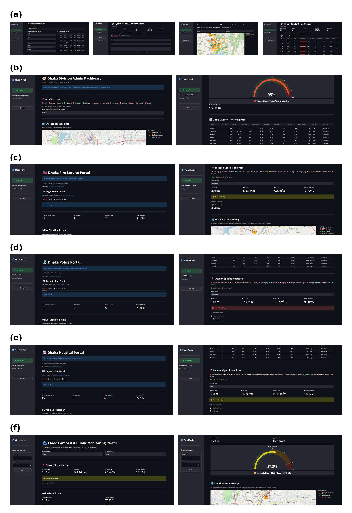
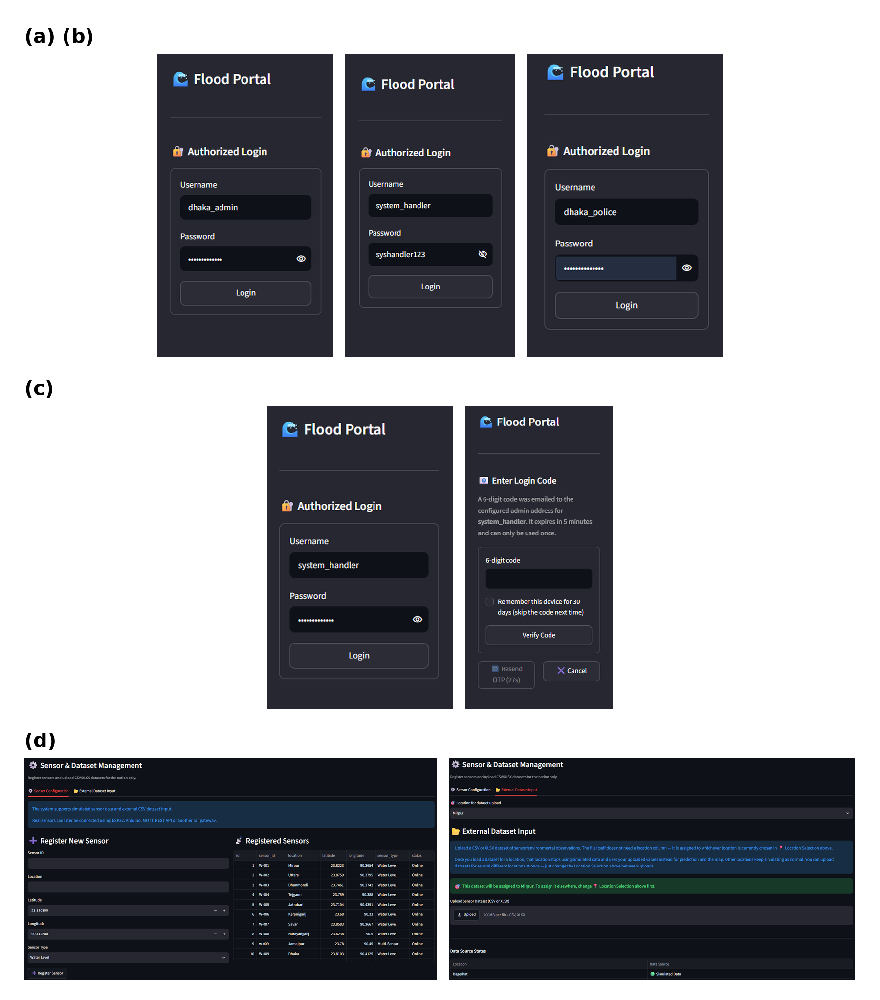
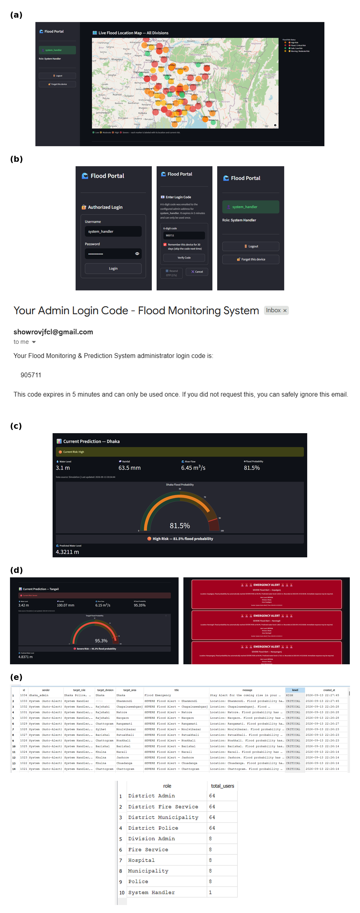
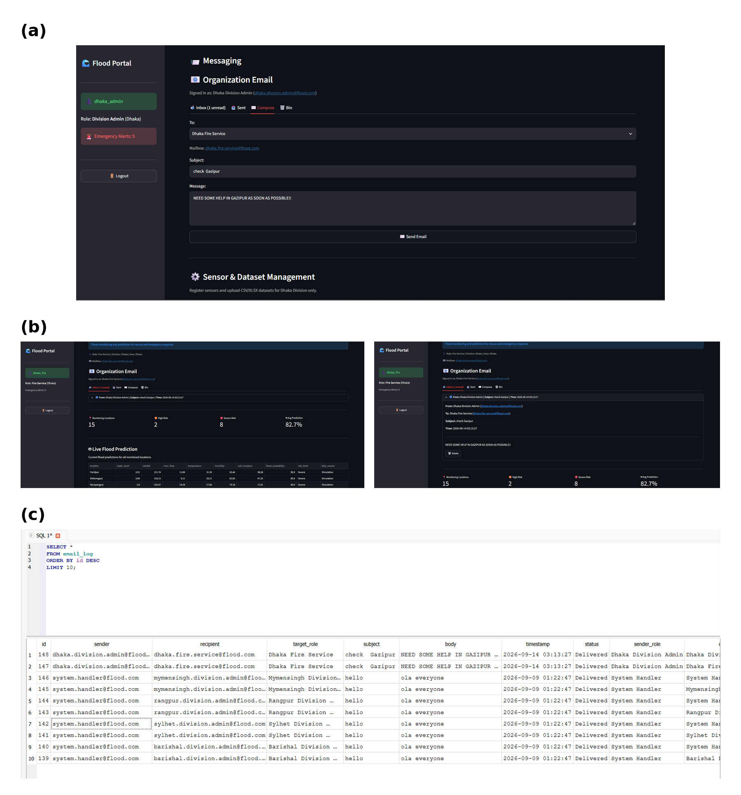
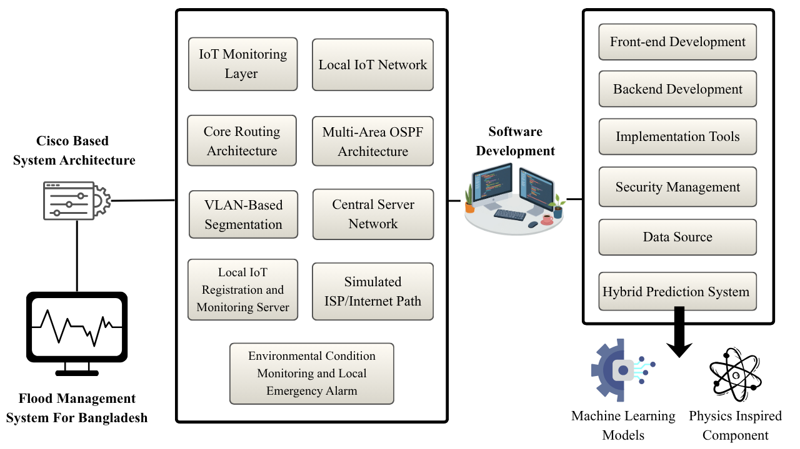
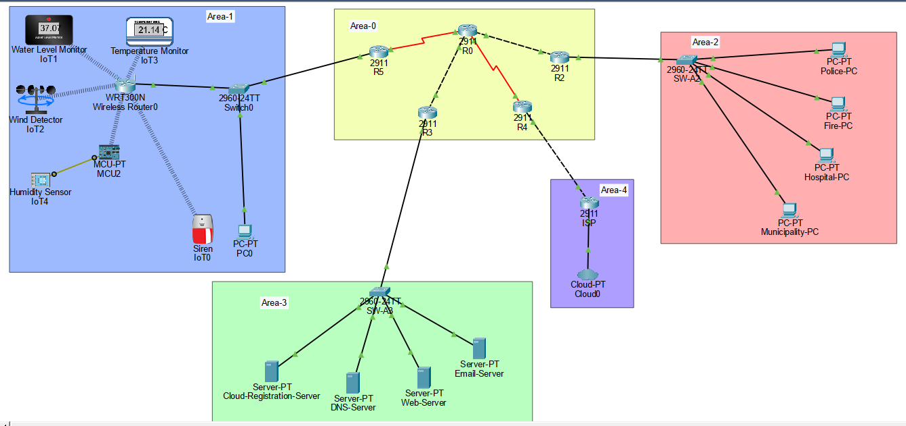
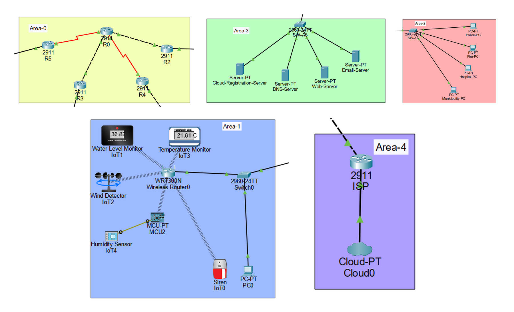
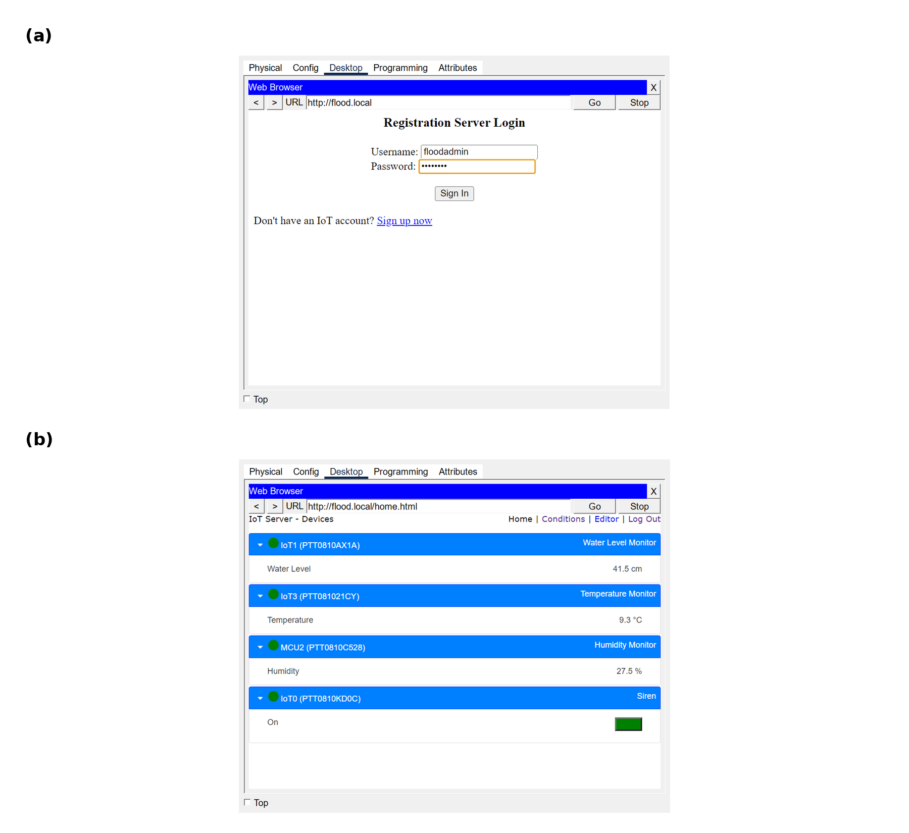

# BonnaGuard

**Flood monitoring, prediction and emergency-response platform for Bangladesh**


BonnaGuard is a Streamlit web application that monitors flood risk for all 64
districts in Bangladesh's 8 divisions. It predicts flood risk with a hybrid
physics + machine-learning model, raises emergency alerts, and connects the
System Handler, the Division Admins and the divisional Police, Fire Service,
Hospital and Municipality accounts through role-scoped dashboards and
messaging. The network behind it is prototyped in Cisco Packet Tracer
(multi-area OSPF, departmental VLANs, central servers, IoT sensing and a local
alarm), and the project documents that design alongside the software.

Flooding is one of the most disruptive natural hazards for communities,
infrastructure, transport, agriculture and public services, and it also brings
health risks and loss of life. Low-lying coastal regions of South and East Asia
are affected most, especially where there is no IoT-based flood monitoring or
early prediction. In Bangladesh around 1.1 million people are affected every
year. BonnaGuard puts monitoring, prediction, alerting and coordination between
the responding services in one application.

> **Project status: prototype.** It starts in **simulation mode** (simulated
> sensor readings), with models trained on a synthetic dataset. The first real
> data (an uploaded CSV/XLSX file or a real sensor reading) switches it to
> **live mode**, where the models retrain in the background on real data. It has
> not been deployed with any agency or validated against observed flood events.

## Table of contents

- [Features](#features)
- [Screenshots](#screenshots)
- [Getting started](#getting-started)
- [Usage](#usage)
- [Use cases](#use-cases)
- [Architecture](#architecture)
- [Network design](#network-design)
- [From the Packet Tracer prototype to the software](#from-the-packet-tracer-prototype-to-the-software)
- [Project structure](#project-structure)
- [Tech stack](#tech-stack)
- [Prediction model](#prediction-model)
- [Data modes and automatic retraining](#data-modes-and-automatic-retraining)
- [Roles and access control](#roles-and-access-control)
- [Application details](#application-details)
- [Configuration reference](#configuration-reference)
- [Testing](#testing)
- [Troubleshooting](#troubleshooting)
- [Project status and roadmap](#project-status-and-roadmap)
- [Project information](#project-information)
- [Contributing](#contributing)
- [License](#license)
- [Development notes](#development-notes)

## Features

1. **Monitors flood risk** for every registered location, from simulated
   sensor readings (simulation mode) or from uploaded datasets and real
   sensors (live mode), as a flood probability, a predicted water level and a
   Low/Moderate/High/Severe classification.
2. **Enforces a role hierarchy**: one System Handler, 8 Division Admins and
   each division's Police, Fire Service, Hospital and Municipality accounts
   (41 accounts), each limited to its own geography in the backend, not just
   in the interface. The 64 districts are monitored locations, not account
   levels.
3. **Alerts the right people automatically** when a location reaches Severe
   risk, and lets administrators message each other and the services.
4. **Keeps history** of readings and predictions for review.
5. **Switches to live mode** when real data arrives and **retrains the
   prediction models** on it automatically, with safety checks (the [Data modes and automatic retraining](#data-modes-and-automatic-retraining) section).
6. **Models the network** in a digital twin engine (no dashboard tab at present; see [Digital twin engine](#digital-twin-engine)).

## Screenshots



<p align="center"><em>Figure 3. Role-based system interfaces: (a) System Handler Interface, (b) Division Admin Interface, (c) Fire Service Interface, (d) Police Interface, (e) Hospital Interface and (f) Public Interface.</em></p>



<p align="center"><em>Figure 4. System login, security verification, and data input process: (a) Division Admin Login Interface, (b) System Handler Login using ID and Password, (c) Request for Authentication Code, and (d) Environmental data and dataset input interface.</em></p>



<p align="center"><em>Figure 5. System Output and Database results: (a) Monitoring results after login, (b) Authentication code received for System Handler verification, (c) Hybrid flood forecast results, (d) Flood-risk classification and emergency alerts, and (e) Backend SQLite database records.</em></p>



<p align="center"><em>Figure 6. Communication process with emergency service agencies: (a) an administrator sending a message to the Fire Service, (b) a record of the message sent, and (c) the message received on the Fire Service interface.</em></p>

## Getting started

### Prerequisites

- Python 3.10 or newer (developed and run with 3.12).
- Packages (`requirements.txt`): streamlit, pandas, numpy, plotly, openpyxl,
  streamlit-cookies-controller, scikit-learn (>= 1.4, needed for the
  monotone-constrained forest), xgboost.

### Installation

```bash
git clone https://github.com/Showrov-SV/projectflood.git
cd projectflood
python -m venv .venv
# Windows: .venv\Scripts\activate     Linux/macOS: source .venv/bin/activate
pip install -r requirements.txt
python -m streamlit run flooddashboard.py
```

The app opens in the browser (default http://localhost:8501). On first run it
creates `flood_monitoring.db` with the 41 demo accounts and the default
sensors. Every table uses `CREATE TABLE IF NOT EXISTS` and columns are added
with safe migrations, so an existing database is upgraded in place.

- `openpyxl` is required to read `.xlsx` datasets.
- If scikit-learn and xgboost are both missing, predictions fall back to
  physics-only (never a fabricated ML number); if only one is present, the ML
  estimate uses that one.
- `streamlit-cookies-controller` powers "Remember this device" (System
  Handler) and "Keep me logged in" (other roles).

### First run

1. Open http://localhost:8501. The public portal needs no login: choose a
   division and a district.
2. To try a role, log in from the sidebar with a demo account (the [Demo accounts](#demo-accounts) section).
   The System Handler also needs the emailed one-time code, which requires
   the email settings in the [Configuration reference](#configuration-reference) section.
3. The first start creates `flood_monitoring.db` with 41 demo accounts and the
   default sensors, and trains the prediction models once (a few seconds).

Where things are defined: formulas and model settings in `hybrid_model.py`,
the prototype network in `flood_app/network_design.py`, and all other settings
in `flood_app/config.py`.

---

## Usage

1. **Public:** open the app without logging in, choose a division and a
   district to see its map marker, readings and risk.
2. **Any role:** log in from the sidebar (press Enter to submit). The System
   Handler then enters the emailed one-time code.
3. **System Handler:** tabs for Overview, Live Map, Districts, History,
   Alerts, Messages, Data and Activity.
4. **Division Admin:** monitor the division, add sensors or upload datasets
   (own division only), send alerts and messages, review Historical Data.
5. **Police / Fire Service / Hospital / Municipality:** view the division's
   map, readings, prediction, alerts, history and mailbox. Click **Mark
   Emergency Alerts as Read** to stop the siren and banner for that account.
6. **Real data and models (System Handler):** load a dataset under Sensors &
   Data (add a flood outcome column to teach the model real outcomes). The
   system switches to live mode and retrains in the background. To inspect
   the retraining or change the mode, use Python in the project folder:
   `python -c "from flood_app import retraining; print(retraining.get_status())"`.

## Use cases

- **Public awareness.** The front page needs no login. Anyone can see the flood
  condition and the likely risk areas across the country, which supports early
  decisions by people living in risk zones.
- **Role distribution and emergency services.** The country is divided into
  divisions. Each division's Police, Fire Service, Hospital and Municipality
  accounts are connected to their Division Admin, and a central System Handler
  controls and communicates with the Division Admins. Emergency alerts are sent
  when any area of any division reaches flood risk, and the services can message
  each other.
- **Hybrid prediction that keeps working.** The prediction combines a
  mathematical model with machine-learning models (Random Forest and XGBoost).
  If the machine-learning models fail, the mathematical part continues the
  prediction.
- **Historical data.** Readings and predictions are recorded per location, so
  analysts and policy makers can look at the characteristics of flooding in a
  specific area (see [Historical data](#historical-data)).
- **Where it fits.** It suits regions where flood risk can change a lot in a
  short time and where centralised monitoring has limited reach. Bangladesh is a
  good example: a flood can affect more than one administrative area, yet its
  effects can be very local.

## Architecture



<p align="center"><em>Figure 1. Architecture framework and methodology of the proposed Flood Management System for Bangladesh.</em></p>

### Layers

1. **Sensing layer (prototype).** In Packet Tracer, IoT devices (water level,
   wind, temperature, humidity, siren) join a wireless router on the sensor
   LAN. In the software, sensors are registered records and their readings
   are **simulated** (simulation mode) or come from uploaded files / the
   real-sensor entry point (live mode) — Packet Tracer is not connected
   live to the application (see the [Network design](#network-design) section).
2. **Network layer.** Multi-area OSPF network and VLANs described in the [Network design](#network-design) section,
   modelled in `network_design.py` for the digital twin.
3. **Application layer.** Streamlit app: data refresh, prediction, alerts,
   messaging, history, authentication, one dashboard per role (the digital
   twin engine runs in the background without a dashboard tab).
4. **Storage layer.** One SQLite file, `flood_monitoring.db`.

### Runtime workflow

1. On each refresh (every `SIMULATION_REFRESH_SECONDS` = 30 s, shared by all
   users) the app obtains one reading per location: in **simulation mode**
   it generates a simulated reading per registered sensor; in **live mode**
   it uses only real data (the newest real sensor reading, or the latest row
   of an uploaded dataset) and locations without fresh real data show "no
   data". The mode is stored in the database (the [Data modes and automatic retraining](#data-modes-and-automatic-retraining) section).
2. The hybrid model turns each reading into a flood probability and a
   predicted water level (the [Prediction model](#prediction-model) section).
3. `classify_risk()` assigns Low/Moderate/High/Severe.
4. The reading is saved (simulation: `sensor_readings`, kept 30 days; live:
   `live_readings`) and mirrored into the digital twin. In live mode a
   background check may also start a model retrain (the [Data modes and automatic retraining](#data-modes-and-automatic-retraining) section).
5. If a location reaches Severe (>= 90 %) and its 5-minute cooldown has
   passed, an emergency alert is created and routed to that location's
   responsible accounts.
6. Each dashboard shows only its own scope: map, gauge, readings, alerts,
   history, messages.

<!-- Figure 8 is not available yet. When the image is in figures/, delete the two comment lines around the image and caption below.
Show: flowchart of steps 1–6 above: data source (simulation / uploaded file) → validation and cleaning → hybrid prediction → risk classification → storage → automatic alert routing → role dashboards and digital twin


<p align="center"><em>Figure 8. Runtime data flow from sensor input to alerts and dashboards.</em></p>
-->

### Architecture blocks

**Cisco-based system architecture** (network side):

| Block | What it is in this project | Details |
|---|---|---|
| IoT Monitoring Layer | Wireless environmental IoT devices: water level, wind, temperature, humidity | Network design |
| Local IoT Network | Sensor LAN 192.168.10.0/24 with Wireless Router0 (SSID `FLOOD_MONITOR`), Switch0, Server0, PC0 | Network design |
| Core Routing Architecture | R0 as the core router joining R2, R3, R4 and R5 | Network design |
| Multi-Area OSPF Architecture | OSPF process 1: backbone area 0 and areas 1, 2, 3 | Network design |
| VLAN-Based Segmentation | Four department VLANs (Police, Fire Service, Hospital, Municipality) on SW-A2 | Network design |
| Central Server Network | Server farm 192.168.30.0/24 and the central server Server0 | Network design |
| Local IoT Registration and Monitoring Server | Server0 (IoT registration enabled, `flood.local`) and the Flood Alert rule it holds | Network design |
| Simulated ISP / Internet Path | R4, ISP router and Cloud0 | Network design |
| Environmental Condition Monitoring and Local Emergency Alarm | The "Flood Alert" rule that switches the siren on, and the emergency alert web page | Network design |

**Software development** (application side):

| Block | What it is in this project | Details |
|---|---|---|
| Front-end Development | Streamlit dashboards, CSS styling, Plotly charts and maps, role-specific screens | Front-end components |
| Backend Development | Data validation, prediction, storage, authentication, alerts, messaging | Architecture, Project structure, Backend responsibilities |
| Implementation Tools | Python libraries and what each one does | Tech stack |
| Security Management | Salted PBKDF2 passwords, email one-time code, trusted device, RBAC, audit log | Security |
| Data Source | Simulation, uploaded files, real sensors, synthetic training data | Prediction model, Data modes and automatic retraining, Dataset and sensor input |
| Hybrid Prediction System | Physics-inspired component plus Random Forest and XGBoost | Prediction model |

---

## Network design

The network is prototyped in Cisco Packet Tracer and used as a virtual
(digital-twin) model of the intended flood-monitoring network: the topology,
routing, VLANs, servers and the local alarm were built and tested there first,
and the software was then structured to follow it (see
[From the Packet Tracer prototype to the software](#from-the-packet-tracer-prototype-to-the-software)).
The prototype file is `Flood_Monitoring_Emergency_Response_Network_Project.pkt`.
Everything in the device, OSPF, addressing, VLAN and server tables below was read
from its router and server configurations; the software holds the same design as data in
`flood_app/network_design.py` (the single source of truth for the twin).



<p align="center"><em>Figure 2. Cisco Packet Tracer based system architecture.</em></p>

### Device inventory

| Type | Devices |
|---|---|
| Routers (6) | Cisco 2911: R0 (core), R2, R3, R4 (edge), R5, and the ISP router |
| Switches (3) | Cisco 2960-24TT: Switch0 (sensor LAN), SW-A2 (emergency services), SW-A3 (server farm) |
| Wireless | Wireless Router0 (WRT300N, the sensor gateway) |
| Servers (5) | Server0 (IoT registration and monitoring server), Cloud-Registration-Server, DNS-Server, Web-Server, Email-Server |
| PCs (5) | PC0 (control PC); Police-PC, Fire-PC, Hospital-PC, Municipality-PC |
| IoT | Wireless things on SSID `FLOOD_MONITOR`: IoT0 (siren), IoT1 (water level monitor), IoT2 (wind detector), IoT3 (temperature monitor); MCU2 (also on `FLOOD_MONITOR`) with the humidity sensor IoT4 wired to pin A0 |
| Internet | Cloud0 |

### OSPF design

| Area | Router (router ID) | Role | Networks in the area |
|---|---|---|---|
| 0 | R0 (1.1.1.1) | Core / backbone | 10.0.0.0/30, 10.0.0.4/30, 10.0.0.8/30, 10.0.0.12/30, 10.0.0.20/30 |
| 0 + 1 | R5 (6.6.6.6) | Area border router, sensor LAN | 192.168.10.0/24 (area 1); 10.0.0.20/30 (area 0) |
| 0 + 2 | R2 (3.3.3.3) | Area border router, emergency departments | 192.168.20.0 – 192.168.23.0 /24 (area 2); 10.0.0.4/30 (area 0) |
| 0 + 3 | R3 (4.4.4.4) | Area border router, server farm | 192.168.30.0/24 (area 3); 10.0.0.8/30 (area 0) |
| 0 | R4 (5.5.5.5) | Edge router | 10.0.0.12/30; originates the default route (`default-information originate`) |

The Packet Tracer workspace is drawn as five coloured areas: Area-0 (the core
routers R0, R2, R3, R4, R5), Area-1 (IoT sensing and the sensor LAN), Area-2
(the four departments), Area-3 (the server farm) and Area-4 (the ISP router
and Cloud0, the simulated internet path). OSPF itself runs in areas 0–3 only;
the ISP and cloud are outside OSPF, and Area-4 is just the workspace group for
that path. R5, R2 and R3 are area border routers between area 1, 2, 3 and the
backbone (area 0).



<p align="center"><em>Figure 7. Multi-area OSPF architecture in Cisco Packet Tracer (workspace areas 0 to 4).</em></p>

### Links and addressing

| Link | Subnet | Endpoints |
|---|---|---|
| R0 — R2 | 10.0.0.4/30 | R0 Gi0/1 .5 · R2 Gi0/0 .6 |
| R0 — R3 | 10.0.0.8/30 | R0 Gi0/2 .9 · R3 Gi0/0 .10 |
| R0 — R4 | 10.0.0.12/30 (serial) | R0 Se0/3/0 .13 · R4 Se0/3/0 .14 |
| R0 — R5 | 10.0.0.20/30 (serial) | R0 Se0/3/1 .21 · R5 Se0/3/0 .22 |
| R4 — ISP | 10.0.0.16/30 | R4 Gi0/1 .17 · ISP Gi0/0 .18 |
| ISP — Cloud0 | 203.0.113.0/30 | ISP Gi0/1 .1 |

R0 Gi0/0 (10.0.0.1/30) is configured and in OSPF but has nothing attached.
R4 uses a static default route to the ISP (`0.0.0.0/0 via 10.0.0.18`).

### VLAN segmentation

R2 uses router-on-a-stick: sub-interfaces of Gi0/1 with 802.1Q
encapsulation, connected to SW-A2, whose access ports carry one VLAN each.

| VLAN | Department | Subnet / gateway (R2 sub-interface) | Host |
|---|---|---|---|
| 10 | Police | 192.168.20.0/24 · .1 (Gi0/1.10) | Police-PC 192.168.20.10 |
| 20 | Fire Service | 192.168.21.0/24 · .1 (Gi0/1.20) | Fire-PC 192.168.21.10 |
| 30 | Hospital | 192.168.22.0/24 · .1 (Gi0/1.30) | Hospital-PC 192.168.22.10 |
| 40 | Municipality | 192.168.23.0/24 · .1 (Gi0/1.40) | Municipality-PC 192.168.23.10 |
### Servers, services and sensor LAN

| Host | Address | Purpose |
|---|---|---|
| Server0 | 192.168.10.11 (gateway 192.168.10.2) | **IoT registration and monitoring server** (IoT registration enabled): the IoT devices register here and their states are viewed in the IoT monitoring interface at `http://flood.local`. The DNS record `flood.local` points to this server |
| PC0 | 192.168.10.10 (gateway 192.168.10.2 = R5) | Control PC |
| Wireless Router0 | 192.168.10.1 | Wireless gateway for the IoT sensors |
| Cloud-Registration-Server | 192.168.30.10 | Included as the **database of the system**. In the software this role is played by the SQLite database |
| DNS-Server | 192.168.30.11 | Name resolution; the configured record is `flood.local` -> 192.168.10.11 (Server0) |
| Web-Server | 192.168.30.12 | HTTP service. Its home page is the emergency flood alert page (see Local alarm automation below) |
| Email-Server | 192.168.30.13 | Mail for the `flood.com` domain, with mailboxes for admin, police, fire, hospital and municipality. A test email was exchanged successfully between configured clients |

The emergency departments reach the central server across the backbone
(R2 -> R0 -> R5), and alerts to them follow the reverse route; this is the
path the digital twin traces (see [How the software models the network](#how-the-software-models-the-network)).

### IoT devices and data flow

- **IoT0** is a siren actuator used for the local emergency alarm demonstration.
- **IoT1** is the water level monitor, **IoT2** the wind detector and **IoT3** the temperature monitor.
- IoT0, IoT1, IoT2, IoT3 and **MCU2** join the WRT300N wireless router wirelessly (SSID `FLOOD_MONITOR`).
- The humidity sensor **IoT4** is connected to MCU2 by wire (pin A0).
- Wireless Router0 connects to Switch0 over Ethernet; Switch0 also connects Server0, PC0 and R5.

Data flow: **IoT devices -> Wireless Router0 -> Switch0 -> R5 -> R0 -> network areas and central services.**
Server0 registers the local IoT devices and carries out the monitoring.



<p align="center"><em>Figure 15. The IoT registration server login at flood.local, and the IoT Server device page showing the water level, temperature and humidity monitors and the siren.</em></p>

### How the software models the network

`network_design.py` lists every node above with its parent, OSPF area, VLAN and
address; the twin (`digital_twin.py`) builds its graph from it and adds one
node per registered sensor under the sensor gateway. See the [Digital twin engine](#digital-twin-engine) section for the
twin's behaviour. Because the prototype is a tree, one router failure cuts off
everything beneath it; this is a property of the prototype, not of the twin.

### What is and is not connected

- **Not connected live:** Packet Tracer cannot feed readings into Streamlit.
  The link between the two is the shared design (`network_design.py`), not a
  data connection.
- **Telemetry hook:** the twin has `set_node_status()` so a real monitor
  (SNMP, ping) could report router/switch/server status later.
- **Known prototype gap (not changed in the `.pkt`):** the ISP router has no
  route back to 192.168.10.0/24 or 10.0.0.20/30, so hosts on the sensor LAN
  cannot receive replies from the internet cloud until those routes are added.

### Local alarm automation and the emergency alert page

The prototype monitors several environmental conditions. Water level is the
primary flood indicator; wind, temperature and humidity are supporting
conditions. The configured prototype conditions are:

| Indicator | Prototype condition | Role |
|---|---|---|
| Water level (IoT1) | >= 80.0 cm | Primary flood/alarm indicator |
| Wind (IoT2) | Wind detected | Supporting indicator |
| Temperature (IoT3) | >= 30.0 °C | Supporting indicator |
| Humidity (MCU2 / IoT4) | >= 80.0 % | Supporting indicator |

1. **"Flood Alert" rule** (on Server0, in the IoT monitoring interface). It is
   a logical AND of the four conditions above: when all hold, the siren (IoT0)
   is switched on.
2. **Emergency alert page** (home page of Web-Server). The page "FLOOD MONITORING
   SYSTEM - EMERGENCY FLOOD ALERT" states that the water level has reached a
   critical condition and offers a "send flood alert" link that opens a
   pre-filled urgent email to the police, fire, hospital and municipality
   mailboxes of the `flood.com` domain. The email is sent by a person; it is
   not triggered automatically.

The 80 cm value and the other thresholds are configurable prototype parameters.
The prototype demonstrates a configurable local alarm; it does not claim that
a specific water level universally defines flooding. Automatic IoT-triggered
email or notification and remote emergency escalation are **not** implemented
in Packet Tracer. These rules are independent of the application's hybrid
model, whose alerts are triggered by the predicted flood probability (the
[Emergency alerts](#emergency-alerts) section).

---

<!-- Figure 14 is not available yet. When the image is in figures/, delete the two comment lines around the image and caption below.
Show: two Packet Tracer screenshots: the "Flood Alert" rule in the IoT monitoring interface on Server0 (water level, wind, temperature and humidity conditions leading to the siren) and the emergency flood alert web page on Web-Server


<p align="center"><em>Figure 14. The prototype's local alarm: the Flood Alert rule that switches the siren on, and the emergency alert page.</em></p>
-->

## From the Packet Tracer prototype to the software

The Packet Tracer network is used as a digital twin of the intended system: a
virtual replica in which the structure was fixed before it was implemented in
software. The software then follows that structure part by part:

| In the Packet Tracer prototype | In the software |
|---|---|
| IoT devices: water level (IoT1), wind (IoT2), temperature (IoT3), humidity (IoT4/MCU2) | Registered sensors and their readings (water level, wind speed, temperature, humidity, plus rainfall, river flow and soil moisture) |
| Siren actuator (IoT0) and the local alarm rule | Emergency alerts with the siren and alert banner (the *Emergency alerts* section) |
| Sensor LAN: WRT300N, Switch0, R5 | The data path from sensors to the application (sensor registry, `ingest_sensor_reading()`) |
| Server0: IoT registration and monitoring server, `flood.local` | The application server that hosts the monitoring dashboards and the sensor registry |
| Cloud-Registration-Server (the system database) | The SQLite database `flood_monitoring.db` |
| Email-Server and the `flood.com` mailboxes (admin, police, fire, hospital, municipality) | The internal mail and messaging module and its role mailboxes |
| R2 with VLANs 10, 20, 30, 40 (Police, Fire Service, Hospital, Municipality) | The four emergency-service roles, each with its own isolated, division-scoped view |
| R3 and SW-A3 server farm: DNS, Email, Web, registration | Central services: name/host, mail, web access and storage inside one application |
| R4, ISP router and Cloud0 (simulated internet path) | Access to the dashboards over the web, including the public portal |
| Admin mailbox / administrative users | The System Handler and the Division Admins |

The same design is kept in `flood_app/network_design.py`, and the digital
twin engine (`digital_twin.py`) builds its graph from it, adds one node per
registered sensor, and can trace the alert path to a department and show what
is cut off when nodes fail (see the [Digital twin engine](#digital-twin-engine) section).
The Packet Tracer file itself is a simulation and is not connected live to the
application.

## Project structure

```
flooddashboard.py        entry point: page setup and role routing
hybrid_model.py          physics + machine-learning prediction framework
flood_app/               application code, one file per responsibility
    config.py              settings (login/OTP limits, refresh timer, thresholds, colours)
    geography.py           divisions, districts, coordinates, lookups
    mail_roles.py          internal mail roles / mailbox keys
    database.py            SQLite connection, table creation, account seeding
    auth.py                login, admin lockout, email OTP (2FA), trusted devices
    passwords.py           salted PBKDF2 password hashing + legacy-hash upgrade
    activity_log.py        login history + audit trail (activity_log table)
    network_design.py      the Packet Tracer prototype network, as data
    digital_twin.py        digital twin: topology, sync, reachability, what-if
    prediction.py          flood probability, risk levels, hybrid prediction
    datasets.py            CSV/XLSX dataset reading, cleaning, label detection and prediction
    data_mode.py           simulation / live mode, storage of real readings, ingest_sensor_reading()
    retraining.py          automatic background retraining, model versions, rollback
    sensors.py             sensors, simulated readings + refresh timer
    messaging.py           internal email and legacy notifications
    alerts.py              emergency alerts, automatic alerts, read/unread
    alert_sound.py         siren sound data
    maps.py                risk colours and the flood map
    alert_ui.py            alert banner and emergency siren panel
    mail_ui.py             message center, mail server panel, email center
    prediction_ui.py       gauge, prediction details, model information
    data_ui.py             dataset upload panel, sensor & dataset management
    sidebar.py             login form, 2FA step, account info
    twin_ui.py             digital-twin panel (not used by any dashboard at present)
    history_ui.py          historical readings chart, table and CSV download
    dashboard_public.py    public dashboard
    dashboard_division.py  Division Admin dashboard
    dashboard_org.py       Police / Fire Service / Hospital / Municipality portals
    dashboard_system_handler.py  System Handler control center
.streamlit/secrets.toml  email settings for the System Handler's one-time code
```

Where to look: **settings** in `config.py`, **database tables** in
`database.py`, **what a role sees** in its `dashboard_*.py`, **shared
screens** in the `*_ui.py` files. A file imports only from files above it in
this list, so there are no circular imports.

### Module responsibilities

| Concern | Modules |
|---|---|
| Prediction | `hybrid_model.py` (maths, models, cache), `prediction.py` (batch use, risk levels) |
| Data in | `sensors.py` (simulation, registration), `datasets.py` (CSV/XLSX), `data_mode.py` (live mode, real readings) |
| Retraining | `retraining.py` (background retrain, versions), `hybrid_model.py` (`train_with_real_data`) |
| People | `auth.py`, `passwords.py`, `activity_log.py`, `mail_roles.py` |
| Communication | `alerts.py`, `messaging.py`, `mail_ui.py`, `alert_ui.py` |
| Network model | `network_design.py`, `digital_twin.py`, `twin_ui.py` |
| Presentation | `dashboard_*.py`, `maps.py`, `prediction_ui.py`, `history_ui.py`, `sidebar.py` |
| Storage | `database.py` |

## Tech stack

| Library | Used for |
|---|---|
| Streamlit | The web application, page layout, widgets, session state |
| CSS (injected through Streamlit) | Visual styling of the dashboards |
| pandas, NumPy | Data handling, numerical computation, vectorised prediction |
| Plotly | Interactive charts and the flood map |
| SQLite (`sqlite3`) | Permanent storage: accounts, sensors, readings, alerts, messages, logs |
| OpenPyXL | Reading Excel datasets |
| scikit-learn | Random Forest model, train/test split, metrics |
| XGBoost | Gradient-boosted model |
| `smtplib`, `email` (standard library) | Sending the System Handler's one-time code by email |
| `hashlib` (standard library) | PBKDF2-HMAC-SHA256 password hashing and hashing of codes and tokens |
| `secrets` (standard library) | Random values for one-time codes and tokens |
| streamlit-cookies-controller | Browser cookies for trusted devices and "keep me logged in" |

---

## Prediction model

### How it works

Implemented in `hybrid_model.py` — Streamlit-independent, so it can be
read, imported, and tested on its own by anyone reviewing the
modeling logic.

**Physics-inspired component** - a weighted flood-risk score from five
sensor values (water level W, rainfall R, river flow F, soil moisture SM,
humidity H):

```
S = 18*W + 0.28*R + 2.5*F + 0.12*SM + 0.08*H
P_physics = 100 / (1 + e^(-k*(S - S_ref)))        k = 0.03,  S_ref = 90
```

S_ref is anchored to a stated "moderate conditions" scenario (2.5 m
water level, 60 mm rain, flow 6, 50 % soil moisture, 70 % humidity gives
S of about 88, so roughly even odds); k, S_ref and the water-level
response below are hand-chosen, not fitted to observed floods.

The component also gives a short-term **water-level estimate in metres**:
the observed level plus 5 % of the extra load (`S/18 - W`: rainfall,
river inflow, wet soil) that S adds on top of it - typically a rise of a
few cm to a few tens of cm. It is a documented heuristic, not a hydraulic
solver (explicitly *not* a Saint-Venant model, and the code says so).
This is the "Predicted Water Level" the dashboards show.

**Machine learning component** - two ensemble regressors, both genuinely
trained via `.fit()` on the seven raw sensor values **plus** the
physics-derived features (S, P_physics and the water-level estimate):

- Random Forest (scikit-learn): 250 trees, max depth 14, min leaf size 2
- XGBoost: 300 rounds, max depth 7, learning rate 0.05, row and column
  subsampling 0.85
- Both are constrained to be **monotone non-decreasing** in water level,
  rainfall, river flow, soil moisture, humidity and the three physics
  features: more water can never lower the predicted risk (verified over
  200 random sweeps; needs scikit-learn >= 1.4). Temperature and wind
  speed are unconstrained.

They are trained on a physics-informed **synthetic** dataset of 5,000
rows with an 80/20 train/test split (there is no bundled real historical
flood dataset for Bangladesh, and the code is honest about that). The
synthetic label is a nonlinear "hydrological stress" function that is
deliberately different from S: effective rainfall that depends on soil
wetness, a compounding water-level x rainfall term, small temperature and
wind effects, and noise. Held-out metrics are computed for real, not
hard-coded (1,000 test rows): Random Forest R^2 0.952 / MAE 3.39,
XGBoost R^2 0.962 / MAE 3.06, ML ensemble 0.960 / 3.08, **hybrid 0.951 /
3.40**, physics-only 0.909 / 4.81 (MAE in probability points). These
measure how well the models learned the synthetic relationship, not
accuracy on real floods; on this synthetic test the blend clearly beats
physics alone and is close to the ML ensemble alone, trading a little
synthetic accuracy for the physics prior. The figures above are
for the original synthetic-trained models. Simulated readings are **never**
used for training; real data can retrain the models only in live mode
(the [Data modes and automatic retraining](#data-modes-and-automatic-retraining) section).

**Hybrid combination**

```
P_ml     = 0.5 * P_RandomForest + 0.5 * P_XGBoost
P_hybrid = 0.60 * P_ml + 0.40 * P_physics
```

If an ML model is unavailable the remaining one is used alone; if neither
is available the result is `P_physics` alone, so predictions keep working
and a missing ML number is never faked. Every probability is rounded and
capped at 99.9 %. Temperature and wind speed feed only the ML models;
the physics score uses the five variables above. The ML models' own inputs already
include every physics-derived feature, so physics shapes the result twice
over.

**Where this shows up in the UI**: the Division Admin
dashboard show a "Predicted Water Level" metric and an expandable
"How this prediction was produced" explanation. Police, Fire Service,
Hospital, Municipality, and the Public Portal deliberately do **not**
show any of this — no "Hybrid Physics + ML" label, no model name, no
feature importances — those views just show the risk status itself.

<!-- Figure 9 is not available yet. When the image is in figures/, delete the two comment lines around the image and caption below.
Show: block diagram: seven raw sensor readings → physics score S → P_physics (sigmoid) and water-level estimate; raw readings + S + P_physics + estimate → Random Forest and XGBoost → P_ml = 0.5/0.5 average; P_hybrid = 0.60·P_ml + 0.40·P_physics; fallback arrow to P_physics when ML is unavailable


<p align="center"><em>Figure 9. Prediction pipeline of the hybrid model.</em></p>
-->

### Training data and simulation procedure

No real historical flood dataset for Bangladesh is bundled, so the ML models
are trained on a **physics-informed synthetic dataset** generated by
`generate_synthetic_training_data()` (5,000 samples, seed 42):

| Variable | Training distribution | Runtime simulation range (`sensors.py`) |
|---|---|---|
| Water level (m) | uniform 0.2 – 6.0 | uniform 1.0 – 4.8 |
| Rainfall (mm) | gamma(2, 35), capped 0 – 300 | uniform 5 – 150 |
| River flow | uniform 0.2 – 25 | uniform 1 – 15 |
| Temperature (°C) | uniform 15 – 40 | uniform 24 – 34 |
| Humidity (%) | uniform 25 – 100 | uniform 55 – 98 |
| Soil moisture (%) | uniform 5 – 100 | uniform 30 – 98 |
| Wind speed | uniform 0 – 45 | uniform 1 – 20 |

Physics-derived features (S, P_physics, water-level estimate) are computed by
the same physics code used at run time. The **label** comes from
`synthetic_flood_label()`: a nonlinear hydrological-stress function —
effective rainfall that depends on soil wetness, a compounding water-level ×
rainfall term, small temperature (evaporation) and wind effects, and Gaussian
noise — passed through a logistic function. It is deliberately different from
S, so the ML models have something to learn beyond the linear score. Every
constant in it is an assumption chosen for plausibility, not a fitted value.

**Preprocessing for uploaded files** (`datasets.py`): required columns
`water_level, rainfall, river_flow, temperature, humidity, soil_moisture,
wind_speed`; common column-name variants are normalised; invalid rows are
reported rather than silently kept. Simulated readings are **never** used for
training. Uploaded files and real sensor readings are prediction input and,
in live mode, also training data for the automatic retraining (the [Data modes and automatic retraining](#data-modes-and-automatic-retraining) section).

### Model configuration

| Item | Value |
|---|---|
| S | 18W + 0.28R + 2.5F + 0.12SM + 0.08H |
| Sigmoid | S_ref = 90, k = 0.03; probability capped at 99.9 % |
| Water-level estimate | W + 0.05·(S/18 − W) |
| Random Forest | 250 trees, max depth 14, min leaf 2 |
| XGBoost | 300 rounds, max depth 7, learning rate 0.05, subsample 0.85, colsample 0.85 |
| Monotonicity | both models non-decreasing in W, R, F, SM, H and the three physics features |
| Features (10) | 7 raw readings + S, P_physics, water-level estimate |
| Split | 80 / 20 (4,000 train, 1,000 test), seed 42 |
| ML ensemble | P_ml = 0.5·P_RF + 0.5·P_XGB |
| Hybrid | P_hybrid = 0.60·P_ml + 0.40·P_physics |
| Fallback | P_physics only if neither ML model is available; the result reports which components ran |

### Evaluation results

Measured on the 1,000 held-out synthetic test samples (`train_hybrid_ml_model()`
returns physics-only, ML-ensemble and hybrid under `["evaluation"]` and the two
individual models under `["random_forest"]` / `["xgboost"]`; MAE is in probability
points):

| Model | R² | MAE |
|---|---|---|
| Physics only | 0.909 | Network design |
| Random Forest | 0.952 | Architecture |
| XGBoost | 0.962 | Architecture |
| ML ensemble | 0.960 | Architecture |
| **Hybrid** (0.6 ML + 0.4 physics) | **0.951** | **3.40** |

To reproduce:

```bash
python -c "import hybrid_model as h; b = h.train_hybrid_ml_model(); print(b['evaluation']); print(b['random_forest']['r2_score'], b['random_forest']['mae'], b['xgboost']['r2_score'], b['xgboost']['mae'])"
```

**How to read these numbers.** They show how well each model reproduces the
*synthetic* labels. They are **not** accuracy on real floods. On this test the
hybrid is clearly better than physics alone and close to the ML ensemble
alone, trading a little synthetic accuracy for the physics prior and the
fallback. Monotonicity was checked numerically: along sweeps of each physical
driver (200 random sweeps) the hybrid output never decreased.

<!-- Figure 10 is not available yet. When the image is in figures/, delete the two comment lines around the image and caption below.
Show: bar chart of R² and MAE for physics-only, Random Forest, XGBoost, ML ensemble and hybrid (values from the table in 6.4), or a predicted-vs-label scatter of the hybrid on the 1,000 test samples


<p align="center"><em>Figure 10. Held-out performance of each component on synthetic data. Not a measure of real-flood accuracy.</em></p>
-->

### Risk thresholds

```
< 50%       → 🟢 Low
50 – 69.99% → 🟡 Moderate
70 – 89.99% → 🟠 High
≥ 90%       → 🔴 Severe
```

Defined once, in `classify_risk()` — every other place that shows a
risk level (map markers, risk badges, the gauge, automatic alerts)
calls this same function, so they can never disagree with each other.

## Data modes and automatic retraining

**Two data modes** (`flood_app/data_mode.py`; the mode is stored in the
`app_settings` table, so it survives restarts):

| | Simulation mode (default) | Live mode |
|---|---|---|
| Readings | Simulated for every registered sensor | Real data only: uploaded datasets and real sensors |
| Models | The original synthetic-trained models, untouched | Retrained automatically on real data (below) |
| Stored in | `sensor_readings` | `live_readings` (simulated rows never go there) |
| No data | — | A location with no fresh real reading shows "no data"; a real sensor silent for more than `LIVE_SENSOR_MAX_AGE_MINUTES` (60) counts as no data |
| Switch | Automatic to live when real data is connected (`LIVE_MODE_AUTO_SWITCH`) | Back to simulation only in code: `data_mode.set_data_mode("simulation", reason=..., changed_by=...)` (there is no dashboard control for it) |

There is no mode banner on the dashboards; the "Data source" line in the prediction panels shows whether a value is simulated or real. Uploaded datasets are saved in
the database, so they survive refreshes and restarts and are shared by all
users. **Note:** the switch is system-wide. The first real dataset uploaded by
any Division Admin or the System Handler puts the whole system into live
mode, so locations without real data then show "no data" until real data
arrives or the System Handler switches back.

**Real sensor entry point.** A real sensor (an HTTP endpoint, MQTT listener or
serial reader that you add) calls one function; the transport itself is not
implemented yet:

```python
from flood_app.data_mode import ingest_sensor_reading
ok, result = ingest_sensor_reading(
    "SENSOR-ID",   # must already be registered under Sensor Configuration
    {"water_level": 2.4, "rainfall": 35.0, "river_flow": 6.2, "temperature": 29.0,
     "humidity": 82.0, "soil_moisture": 61.0, "wind_speed": 9.0},
    timestamp=None,  # default: now
    label=None,      # optional real flood outcome, 0-100 (or 0/1)
)
```

The reading is validated (numbers, finite, same plausibility limits as uploaded
datasets), predicted, stored and switches the system to live mode. It never
raises for bad input; it returns `(False, message)`.

**Automatic retraining** (`flood_app/retraining.py`, live mode only):

1. **When:** in a background thread (the dashboard never freezes), right after
   a dataset is loaded, and then whenever `RETRAIN_MIN_NEW_ROWS` (200) new
   real rows have arrived and at least `RETRAIN_MIN_INTERVAL_MINUTES` (30)
   have passed. A retrain can also be forced from code with `retraining.request_retrain(force=True)`.
2. **Training data:** the synthetic base set **plus** the real rows (up to
   `RETRAIN_MAX_REAL_ROWS`), so the model never depends on a small real set.
3. **Labels** decide what the model can learn:
   - A real row **with a label** teaches what actually happened. Put a column
     named `flood_probability`, `flood_label`, `flood_occurred` or `flood`
     in the file (0/1 or 0–100), or pass `label=` to `ingest_sensor_reading`.
     Labelled rows together get about `RETRAIN_LABELED_SHARE` (70 %) of the
     training weight (each row counts between `RETRAIN_LABELED_WEIGHT` = 5 and
     `RETRAIN_MAX_LABELED_WEIGHT` = 50 times), so real outcomes can outweigh the
     5,000 assumed synthetic rows.
   - A real row **without a label** cannot teach the truth. If
     `RETRAIN_USE_UNLABELED` is on, it gets a weak label from the synthetic
     label function, so the model only learns the value ranges of your data.
   - A file exported from this app is never used as labels (the model would be
     learning from itself).
4. **Acceptance:** a new model replaces the live one only if it passes checks
   on held-out rows. With enough labelled rows it must beat the old model's
   error (MAE) on held-out labelled rows **and** explain at least
   `RETRAIN_MIN_LABEL_R2` (0.15) of their variance, which rejects wrong or
   random label columns. With few or no labels it may be at most slightly worse
   on held-out real rows and not more than `RETRAIN_MAX_SYNTHETIC_DEGRADATION`
   (25 %) worse on synthetic rows. Otherwise the old model is kept and the
   reason is shown.
5. **Versions:** every accepted model is a numbered version (files
   `.hybrid_model_live_v<n>.joblib`, last `RETRAIN_KEEP_VERSIONS` = 5 kept).
   New models are picked up automatically, with no restart. The System Handler
   can roll back to the original model at any time with
   `retraining.rollback_to_original()` (there is no dashboard control for it).

All of this keeps the model structure, formulas and hyperparameters of
the [Prediction model](#prediction-model) section unchanged; only the training data and sample weights differ.
The metrics in 6.4 belong to the original synthetic-trained model. A retrained
version reports its own held-out numbers (`retraining.get_status()`), and
`prediction_ui` shows what the active models were trained on.

**What this does not prove.** The mechanism is tested (acceptance, rejection of
random labels, rollback) but it has **not** been validated on observed flood
events. Rows without outcome labels do not make the model more accurate about
floods, only more familiar with the data's ranges.

---

## Roles and access control

<!-- Figure 11 is not available yet. When the image is in figures/, delete the two comment lines around the image and caption below.
Show: tree: System Handler → 8 Division Admins → each division's Police, Fire Service, Hospital and Municipality accounts (41 accounts); public portal shown separately with no login


<p align="center"><em>Figure 11. Role hierarchy and scope of each account type.</em></p>
-->

```
                       System Handler
                              │
                    ┌─────────┴─────────┐
                    │    8 Divisions     │
                    └─────────┬─────────┘
                              │
          Division Admin, Division Police, Division Fire
          Service, Division Hospital, Division Municipality
                 (5 accounts × 8 divisions = 40)
```

**Total accounts: 41** (1 + 40).

- **System Handler** — the sole national-level account (Administrator
  2FA applies here). Sees all 8 divisions, all 64 monitored districts,
  nationwide map/prediction/alerts, and can message
  any Division Admin individually or all of them at once.
- **Division Admin** — administrator capabilities restricted to their
  own division's districts only.
- **Division Police, Fire Service, Hospital, Municipality** — each sees
  only their own division's map, live sensor readings, and prediction;
  each has its own private mailbox and emergency-alert state,
  completely isolated from every other account.

There is no District Admin tier and there are no district-level
accounts (an older build had 256 of them; they are removed
automatically from any older database on startup, together with their
mailbox and alert-read rows).

### Sensor and dataset access

**Only System Handler and Division Admins can
register sensors or upload CSV/XLSX datasets.** Police, Fire Service,
Hospital, and Municipality accounts — at every level — have zero
access to sensor registration or dataset upload; they are monitoring
and communication accounts only. This is enforced by simply never
rendering or calling those functions from their dashboard, not by
hiding a button behind a permission flag.

Where access does exist, it's also scoped geographically and enforced
at the database-write level, not just in the UI:

- System Handler can register/upload anywhere.
- A Division Admin's sensor form only offers their own division's
  districts, **and** the backend independently rejects any submission
  outside that division even if the UI restriction were bypassed.

### Demo accounts

> **These are DEFAULT DEMO credentials, created automatically on first
> run so the prototype is usable out of the box. They are public in
> this README, so never expose an instance that still uses them - change
> them (or delete the accounts you don't need) before any real
> deployment.** Email settings for the System Handler's one-time code go
> in `.streamlit/secrets.toml` (see the [Configuration reference](#configuration-reference) section).

Credentials follow a predictable pattern:

| Role | Username pattern | Password pattern |
|---|---|---|
| System Handler | `system_handler` | `syshandler123` |
| Division Admin | `<division>_admin` | `<division>admin123` |
| Division Police/Fire/Hospital/Municipality | `<division>_police` etc. | `<division>police123` etc. |

(division names lowercased, e.g. `dhaka_admin` / `dhakaadmin123`.) Query
the `users` table directly if you need the exact list for your
database — see below.

The login form is a proper Streamlit form: press **Enter** after
typing your password instead of clicking **Login**; same at the OTP
step.

---

## Application details

### Dataset and sensor input

Required columns: `water_level`, `rainfall`, `river_flow`,
`temperature`, `humidity`, `soil_moisture`, `wind_speed` (`sensor_id`
and `timestamp` optional). Common column-name variants are normalized
automatically. Both CSV and XLSX are supported. An optional `flood_probability` /
`flood_label` / `flood_occurred` / `flood` column carries the real outcome and
is used as a training label (the [Data modes and automatic retraining](#data-modes-and-automatic-retraining) section). Uploading a dataset stores it in
the database (it survives refresh and restart and is shared by all users) and
switches the system from simulation to **live mode**; prediction for that
location uses the latest uploaded record. "Remove Dataset" deletes that
location's stored dataset but does not switch back to simulation; only the
switching back to simulation (done in code only).

### Emergency alerts

- **Automatic**: the moment any location's prediction reaches
  **Severe (≥90%)**, an alert fires with no admin click needed —
  routed to that location's division-level Police/Fire
  Service/Hospital/Municipality, its Division Admin, and System
  Handler. A 5-minute
  per-location cooldown prevents the same location from spamming new
  alerts every time the simulator re-randomizes its readings.
- **Manual**: Division Admin and System Handler can
  also send alerts on demand to their own scope.
- **Delivery**: a large, continuously blinking red banner plus an
  automatically-playing siren sound (offline-generated, no internet
  dependency), until **"Mark Emergency Alerts as Read"** is clicked —
  which stops both immediately and is completely independent per
  recipient (marking Dhaka Police's alerts read never touches Dhaka
  Hospital's).
- **Performance-capped rendering**: only the 8 most recent alerts are
  ever rendered as full cards at once, with an accurate "showing 8 of
  N" notice when there's a larger backlog — clicking "Mark as Read"
  still clears the entire backlog in one click, not just what's
  shown. (This was added after an account was found with 400+ unread
  alerts silently rendering as 400+ blinking divs on every page
  load — see Performance notes below.)
- Every alert-receiving role has a live **"🚨 Emergency Alerts: N"**
  indicator in the sidebar.

### Map and gauge

- Every marker is always labeled with its risk circle + location name
  directly on the map, sized so even low-probability readings are
  never shrunk to an invisible dot.
- A 0–100% gauge shows the current probability with colored zone
  bands matching the thresholds above, rendered with an explicitly
  opaque background and matching text color so it stays readable
  regardless of whether the surrounding Streamlit theme is light or
  dark.
- Picking a location/district re-centers and zooms the map onto it.

### Public portal

Cascading **Division → District** selectors: pick a division, then
one of its districts, and the portal shows that district's live map
marker, current sensor readings, and prediction/risk status — never
another district's data. No technical model details are shown here
either.

### Historical data

Every reading (and its flood probability and risk level) is stored in
`sensor_readings` and kept for `SENSOR_READING_RETENTION_DAYS` (30 by
default). `flood_app/history_ui.py` shows it: pick a location, a time
window (last hour to last 30 days) and a variable, and get an
interactive per-sensor chart, peak/Severe counts, a risk-level tally,
the stored-readings table and a CSV download. It appears as the
**History** tab for the System Handler (all 64 districts) and as a
**Historical Data** section for each Division Admin and each division
Police / Fire Service / Hospital / Municipality account, limited to
their own division's areas. It only reads the table - nothing is
written or deleted.

In live mode the history shows real readings only (`live_readings`); in
simulation mode it shows the simulated readings (`sensor_readings`).

<!-- Figure 12 is not available yet. When the image is in figures/, delete the two comment lines around the image and caption below.
Show: History tab for a chosen location showing the flood-probability line chart, peak metrics, risk-level tally and the download button


<p align="center"><em>Figure 12. Stored readings and predictions for one location over a selected time window.</em></p>
-->

### Digital twin engine

`flood_app/digital_twin.py` keeps a persistent, synchronised model of
the monitoring network in the `digital_twin_state` table. The network
is the one built in the Cisco Packet Tracer prototype
(`Flood_Monitoring_Emergency_Response_Network_Project.pkt`), defined in
`flood_app/network_design.py`:

| OSPF area | Router | Contents |
|---|---|---|
| 0 | R0 (core, 1.1.1.1) | point-to-point links to R2, R3, R4, R5 |
| 1 | R5 (6.6.6.6) | 192.168.10.0/24 sensor LAN: wireless sensor gateway, Switch0, Server0 (`flood.local`, 192.168.10.11), PC0 |
| 2 | R2 (3.3.3.3) | SW-A2 with VLAN 10 Police, 20 Fire Service, 30 Hospital, 40 Municipality (192.168.20-23.0/24) |
| 3 | R3 (4.4.4.4) | SW-A3 server farm 192.168.30.0/24: Cloud-Registration, DNS, Web, Email (`flood.com`) |
| edge | R4 (5.5.5.5) | default route -> ISP -> Cloud0 |

Every registered sensor is a node attached to the sensor gateway.
Sensor nodes are re-synchronised from the live readings on every data
refresh (`sensors._build_simulation_snapshot` -> `sync_twin`), with
flood risk aggregated to the gateway, core and Server0; a sensor that
stops reporting ages from *Online* to *Stale* to *Offline*
(`TWIN_STALE_AFTER_SECONDS` / `TWIN_OFFLINE_AFTER_SECONDS`).

**Dashboard status:** the Digital Twin tab has been **removed from the System
Handler dashboard**. The engine (`network_design.py`, `digital_twin.py`) and the
panel code (`twin_ui.py`) remain in the repository, and the twin state is still
synchronised in the background, so the tab can be restored by re-adding the
`digital_twin_panel()` tab in `dashboard_system_handler.py`. The engine provides
the topology graph, sensor health by division, the hop-by-hop **alert delivery
path** from Server0 to any department VLAN, and a **what-if failure analysis**
(take routers, switches, the gateway or Server0 down and see which sensors,
departments and servers lose connectivity).

Limits:

- Routers, switches, VLANs and servers have **no live telemetry** in
  this app; they show as *Not monitored* until a real network monitor
  calls `set_node_status(node_id, status)` (that status then survives
  later syncs).
- The network is a pure tree, as in the prototype, so one router failure
  cuts off everything beneath it. Add redundant links with
  `TWIN_EXTRA_LINKS` in `flood_app/config.py`.
- Reachability is plain graph connectivity. No latency or packet-loss
  figures are produced, because none are measured.
- Only the registered-sensor feed (shared by all users) is mirrored;
  per-session dataset uploads are not part of the twin.

### Security

- **System Handler 2FA**: password + emailed one-time code (Gmail
  SMTP via `.streamlit/secrets.toml`), 5-attempt password lockout
  (15-minute lock), 5-minute OTP expiry, one-time use, 30-second
  resend cooldown — all enforced server-side in the database, so a
  page refresh can't reset a lockout or an OTP's state.
- **"Remember this device"** (System Handler) — skips the OTP step
  only on a device that's already verified once; password is always
  still required.
- **Passwords are stored as salted PBKDF2-HMAC-SHA256 hashes**
  (600,000 iterations by default, a fresh random 16-byte salt per
  password, constant-time comparison; `flood_app/passwords.py`,
  setting `PASSWORD_HASH_ITERATIONS` in `flood_app/config.py`).
  Accounts created by an older version (plain unsalted SHA-256) keep
  working and are **upgraded automatically the next time each user
  logs in** — the upgrade is recorded in the activity log as
  `PASSWORD_HASH_UPGRADED`. Accounts that never log in keep their old
  hash until they do, so reset any default password you don't
  actively use. A brand-new database seeds ~300 default accounts,
  which takes a while once (hashing is deliberately slow); after that
  start-up is instant.
- One-time codes and device-trust tokens are stored only as SHA-256
  hashes. That is acceptable for them (unlike passwords) because they
  are short-lived and attempt-limited: an OTP expires in 5 minutes and
  dies after a few wrong guesses, and a device token is a 256-bit
  random value.
- **Login history & activity log** — every login attempt (success,
  wrong password, locked account), OTP outcome (sent / verified /
  expired / wrong), logout, emergency alert or siren (manual and
  automatic), emergency message, sensor registration and dataset load
  is appended to the `activity_log` table (timestamp, username, role,
  division, district, action, status, details). Passwords, OTP codes
  and tokens are never written to it. The System Handler can browse,
  filter (user / action / status / period) and download it as CSV from
  the **🧾 Activity Log** tab. Entries older than
  `ACTIVITY_LOG_RETENTION_DAYS` (default 365, in `flood_app/config.py`)
  are pruned at startup; logging is fail-safe, so a logging problem can
  never block a login or an alert.

### Database

`flood_monitoring.db` — the tables: `users`, `sensors`,
`sensor_readings`, `email_log`, `emergency_notifications` (legacy,
still written for history), `admin_auth_state`, `admin_trusted_devices`,
`remembered_logins`, `emergency_alerts`, `emergency_alert_reads`,
`auto_alert_log`, `activity_log` (login history + audit trail),
`digital_twin_state` (digital twin node state), `app_settings` (data mode,
active model version, retrain state, dataset metadata), `live_readings`
(all real readings, with optional training labels), plus
SQLite's own `sqlite_sequence`. Seven indexes
(`idx_alert_reads_recipient_unread`, `idx_alert_reads_alert_id`,
`idx_notifications_role_status`, `idx_email_log_owner_folder`,
`idx_sensor_readings_timestamp`, `idx_activity_log_time`,
`idx_activity_log_user`) keep the alert/mailbox lookups that run
on every dashboard render, and the history cleanup, fast even as the
tables grow into the thousands of rows.

To inspect it directly: [DB Browser for SQLite](https://sqlitebrowser.org/)
(open the file, Browse Data), the `sqlite3` CLI (`.tables`,
`SELECT * FROM users;`), or a VS Code SQLite extension.

Older databases upgrade in place: `app_settings` and `live_readings` are
created on the next start and nothing is deleted. Retrained models are stored
as `.hybrid_model_live_v<n>.joblib` files next to `hybrid_model.py` (not in
the database).

<!-- Figure 13 is not available yet. When the image is in figures/, delete the two comment lines around the image and caption below.
Show: diagram or DB-browser screenshot of the main SQLite tables: users, sensors, sensor_readings, emergency alerts and reads, email_log, activity_log, digital_twin_state


<p align="center"><em>Figure 13. Main tables of `flood_monitoring.db`.</em></p>
-->

### Front-end components

The dashboards are built from a small set of components, styled with CSS:

- **Login section** in the sidebar, with the two-step code entry for the System Handler.
- **Emergency siren button and alert banner**: a siren panel that can be
  silenced per account, and a banner for unread emergency alerts.
- **Selection menus** (division, district, location, time window, variable)
  and **input fields** (sensor registration, dataset upload, message forms).
- **Data tables** for readings, alerts, messages, accounts and history, with
  CSV download where useful.
- **Status indicators** for risk level and sensor status.
- **Notification bar** for unread alert and message counts.
- **Prediction meter (gauge)** and **Plotly charts and map** for the flood
  probability, readings and risk by location.

### Backend responsibilities

The backend is plain Python modules (no separate server process) that
together act as the central processing unit:

1. Obtain readings (simulation, uploaded files or real sensors) and validate
   and preprocess them.
2. Pass them to the prediction module and classify the risk.
3. Store readings, predictions and history in SQLite.
4. Authenticate users, enforce role scope, and log activity.
5. Generate emergency alerts and carry messages between accounts.
6. Retrain the models in live mode when real data arrives (the [Data modes and automatic retraining](#data-modes-and-automatic-retraining) section).

---

## Configuration reference

- **Settings** (`flood_app/config.py`): login lockout (5 attempts, 15 min),
  OTP length 6 / validity 5 min / 5 attempts / 30 s resend, trusted-device
  cookie 30 days, activity-log retention 365 days, `SIMULATION_REFRESH_SECONDS`
  = 30, `SENSOR_READING_RETENTION_DAYS` = 30, twin stale/offline timers
  (180 s / 600 s), risk colours.
- **Email for the System Handler's one-time code**
  (`.streamlit/secrets.toml`, never commit real values):

```toml
[email]
sender = "your.address@gmail.com"
app_password = "your gmail app password"
admin_2fa_email = "address that receives the code"
```

- **Live mode and retraining** (`flood_app/config.py`):
  `LIVE_MODE_AUTO_SWITCH` (True), `LIVE_SENSOR_MAX_AGE_MINUTES` (60),
  `RETRAIN_ENABLED` (True), `RETRAIN_MIN_REAL_ROWS` (30),
  `RETRAIN_MIN_NEW_ROWS` (200), `RETRAIN_MIN_INTERVAL_MINUTES` (30),
  `RETRAIN_MAX_REAL_ROWS` (50,000), `RETRAIN_LABELED_WEIGHT` (5),
  `RETRAIN_LABELED_SHARE` (0.7), `RETRAIN_MAX_LABELED_WEIGHT` (50),
  `RETRAIN_USE_UNLABELED` (True), `RETRAIN_MAX_SYNTHETIC_DEGRADATION` (0.25),
  `RETRAIN_MIN_LABEL_R2` (0.15), `RETRAIN_KEEP_VERSIONS` (5).
- **Network design** (`flood_app/network_design.py`): edit only if the
  Packet Tracer design changes.
- **Model constants** (`hybrid_model.py`): `S_REF`, `SIGMOID_STEEPNESS_K`,
  `WATER_LEVEL_RESPONSE`, `RANDOM_FOREST_PARAMS`, `XGBOOST_PARAMS`,
  `HYBRID_ML_WEIGHT`, `HYBRID_PHYSICS_WEIGHT`.

## Testing

Automated tests are **not included in this release.** An earlier version of
this README described a pytest suite of about 100 tests under `tests/`, but
that folder is not part of this archive (only `pytest.ini` is present), so no
test results are claimed here. If the suite exists in the GitHub repository,
copy its `tests/` folder into the project root and run `python -m pytest`.

What can be reproduced today is the model evaluation in the [Prediction model](#prediction-model) section (one
command, fixed random seed).

## Troubleshooting

| Problem | Likely cause and fix |
|---|---|
| `ModuleNotFoundError` | Run `pip install -r requirements.txt` in the active environment. |
| Predictions show no ML values / "physics only" | scikit-learn or xgboost is missing; install both. Forest monotone constraints need scikit-learn >= 1.4. |
| First start is slow | The models train once (a few seconds) and are cached in `.hybrid_model_cache.joblib`; delete that file to force retraining after changing model code. |
| One-time code email never arrives | Check `.streamlit/secrets.toml` (`sender`, `app_password`, `admin_2fa_email`); use a Gmail *app password*; check spam. |
| Account locked | 5 wrong passwords lock the admin login for 15 minutes. |
| History tab says "No stored readings" | Readings are saved only while the app is refreshing; wait for a refresh or choose a longer window. |
| Excel upload fails | `pip install openpyxl`; check the required column names (6.2). |
| Port already in use | `python -m streamlit run flooddashboard.py --server.port 8502`. |
| Everything shows "no data" | The system is in live mode and has no fresh real data for that location. Load a dataset / send readings, or switch back to simulation in code (`data_mode.set_data_mode("simulation", reason="manual", changed_by="admin")`). |
| New dataset did not change the model | Retraining only runs in live mode and the new model must pass the acceptance checks; read the reason with `retraining.get_status()["last_report"]`. Unlabelled data only teaches value ranges. |
| Roll back the model | `retraining.rollback_to_original()` (original synthetic model). To remove all retrained versions, delete the `.hybrid_model_live_v*.joblib` files. |
| Start over | Stop the app and delete `flood_monitoring.db` (all stored data, messages and history are lost; demo accounts are recreated). |

## Project status and roadmap

| Area | Implemented | Simulated / synthetic | Assumed (hand-chosen) | Future work |
|---|---|---|---|---|
| Sensing | Sensor registration, dataset upload, validation | Sensor readings (random within ranges, 30 s refresh) | Simulation ranges | Real sensors via the sensor configuration unit (ESP32/Arduino, MQTT, REST) |
| Prediction | Physics score, RF + XGBoost, hybrid blend, monotone constraints, fallback, metrics | Training labels (synthetic stress function) | S coefficients, S_ref, k, water-level response, label constants | Train and calibrate on historical flood data; validate on observed events |
| Network | Packet Tracer design; same design modelled in `network_design.py` | Packet Tracer itself is a simulator | — | Live telemetry (SNMP/ping) via `set_node_status()`; latency measurement; fix ISP return route |
| Digital twin | Engine: topology, sensor sync, alert path, what-if analysis (no dashboard tab at present) | Infrastructure status is "Not monitored" | Tree topology (as prototype) | Redundant links, real device status |
| Users | 41 role-scoped accounts, 2FA for System Handler, activity log | Demo credentials | — | Production account provisioning |
| Alerts | Automatic Severe alerts, cooldown, per-recipient read state, siren, messaging | — | 90 % Severe threshold, 5-minute cooldown | SMS/other channels |
| Live mode and retraining | Automatic live mode, real-reading storage, `ingest_sensor_reading()`, background retraining with acceptance checks, versions, rollback | Retraining is tested with generated data only | Retrain thresholds, weights and acceptance rules | Network transport for real sensors (HTTP/MQTT); validation of retraining on observed floods |
| Deployment | — | — | — | Hosting, hardening, agency pilot |

### Limitations

- The software has **not** been deployed or evaluated with operational
  agencies, and no real flood event was used.
- Reported R² / MAE are measured on synthetic labels only.
- Probabilities are model outputs from hand-set constants; they are not
  calibrated risk estimates.
- The predicted water level is a heuristic index in metres, not a hydraulic
  simulation.
- The digital twin evaluates graph connectivity only (no latency or packet
  loss) and shows infrastructure as "Not monitored".
- Packet Tracer is a simulator and is not live-linked to the application.
- Readings are stored only while the app is running and refreshing; history
  older than 30 days is pruned.
- Retraining on real data is implemented and mechanically tested but has
  not been validated on observed flood events; unlabelled rows only teach
  the value ranges of the data.
- Live mode is system-wide: the first real dataset switches every location
  to real-data-only, so locations without real data show "no data".
- The real-sensor entry point (`ingest_sensor_reading`) exists, but no
  network transport (HTTP/MQTT/serial) is implemented yet.
- Automated tests are not included in this release (see the [Testing](#testing) section).

### Roadmap

Planned next steps, in order of importance:

1. Connect real sensors (add an HTTP/MQTT/serial transport to
   `ingest_sensor_reading()`) and collect real readings and flood outcomes.
2. Train and calibrate the model on historical flood data and validate it on
   observed events, including the retraining described in
   [Data modes and automatic retraining](#data-modes-and-automatic-retraining).
3. Compare more machine-learning models, and deep-learning models, on the
   historical data.
4. Add more detailed land-side data: digital elevation models, river-network
   information, drainage characteristics, land use, soil characteristics, and
   remotely sensed precipitation and water-extent observations.
5. Support finer flood zones inside districts and spatial monitoring.
6. Add more emergency services and other users, for example NGOs and flood
   support centres.
7. In the Packet Tracer prototype: automatic IoT-triggered email or
   notification and remote emergency escalation; fix the ISP return route.
8. Add live network telemetry (SNMP or ping through `set_node_status()`) and
   latency measurement; restore a dashboard view for the digital twin if wanted.
9. Add automated tests, harden and host the application, and pilot it with an
   agency.

---

## Project information

| Item | Value |
|---|---|
| Current code version | v7.5 |
| Repository | https://github.com/Showrov-SV/projectflood |
| License | MIT (see `LICENSE.txt`) |
| Version control | Git |
| Languages and tools | Python, HTML/CSS (through Streamlit), SQLite |
| Main dependencies | Streamlit, pandas, NumPy, Plotly, OpenPyXL, scikit-learn, XGBoost, streamlit-cookies-controller (`requirements.txt`) |
| Authors | Showrov, Sha Farzeen Hossain, Md. Al-Amin Hossian |
| Support | farzeenhossain10@gmail.com / showrovjfcl@gmail.com |

## Contributing

Issues and pull requests are welcome. For larger changes, please open an issue
first. Keep secrets and local state (`.streamlit/secrets.toml`, `flood_monitoring.db`,
model cache files) out of commits; `.gitignore` already excludes them.

## License

Released under the MIT License. See [`LICENSE.txt`](LICENSE.txt).

## Development notes

### Performance notes

With 41 accounts and 64 monitored districts, a few things
that were fine at small scale needed attention:

- Emergency-alert lookups are now indexed (see above) instead of
  doing a full table scan on every sidebar render.
- Alert card rendering is capped to 8 at a time regardless of backlog
  size (see Emergency Alert System above).
- A one-time cleanup removes any emergency-alert rows addressed to
  mailbox keys that no longer correspond to a real account (this
  happened once, when the original 5 legacy accounts were replaced by
  System Handler, and left ~1,300 permanently-unreadable rows behind
  until it was cleaned up).

### Change notes

- The Emergency Messaging / Inbox / Sent / Bin mail system is
  **simulated** — no real SMTP server or internet mail. Unrelated to
  the real Gmail SMTP connection used only for System Handler 2FA.
- Uploaded datasets are stored in the database (they persist across refreshes and restarts).
- To add or adjust a district's coordinates, edit
  `DISTRICT_COORDINATES` in `flood_app/geography.py`.

#### Speed-up changes (latest)

- Sensor predictions are now **batched** (`hybrid_model.hybrid_predict_batch`,
  `flood_app/prediction.py: hybrid_flood_prediction_batch`): one vectorised physics pass and
  one `predict()` call per ML model for all sensors, instead of one full model
  call per sensor. Results are numerically identical to the old per-row path.
- The trained model is cached on disk (`.hybrid_model_cache.joblib`, created
  automatically on first launch, ~5 s once). It is only reused when library
  versions and model settings match; otherwise it retrains. Safe to delete.
- Sensor readings are saved in a single database transaction.
- System Handler alert counts use one grouped query instead of ~300.
- Uploaded datasets are predicted in one batch (20,000 rows in under 1 s) and
  column headers with units, e.g. `Rainfall (mm)` or `Humidity (%)`, are accepted.
- The OTP email now has a 10-second network timeout, so login can't hang if Gmail
  is unreachable.
- `xgboost` was added to `requirements.txt` (the model uses both Random Forest and XGBoost).

#### System Handler Control Center (redesigned)

The System Handler page is now a tabbed control center instead of one long scroll:

- **Headline strip** - locations monitored, Severe count, High count, average flood risk,
  and alert events in the last 24 hours.
- **Overview** - a "Needs attention now" list of every High/Severe location (worst first,
  with water level, predicted level and rainfall), plus one card per division.
- **Live Map** - pick a division and/or a single location; the map frames the chosen markers
  (or zooms in on the chosen location).
- **Districts** - all 64 districts, searchable and filterable by division and risk level,
  with a **Download CSV** button. A district with several sensors is shown at the risk of
  its worst sensor.
- **Alerts** - the recent alert *events* (one row per alert, with "N of M unread"), unread
  copies by division, Mark-all-read, and **Send an emergency alert** (to all divisions or
  one; requires a confirmation tick).
- **History** - stored readings and predictions for any location (see the [Historical data](#historical-data) section).
- **Messages** - message one/all Division Admins and the System Handler mailbox.
- **Sensors & Data** - sensor registration and CSV/XLSX dataset upload.

#### Data refresh

Simulated readings are generated once every `SIMULATION_REFRESH_SECONDS` (default 30) and
shared by all users, so numbers no longer jump around on every click (there is no on-screen
refresh control). Set `SIMULATION_REFRESH_SECONDS = 0` in `flood_app/config.py` to get the old
behaviour back (new readings on every click).
Simulated history older than `SENSOR_READING_RETENTION_DAYS` (default 30; 0 = keep all) is
pruned automatically.

The explanatory "you can only access..." banners were removed from all dashboards; access
restrictions are still enforced in the backend exactly as before.

#### Audit fixes (latest)

- **Security:** alert titles/messages/senders are now HTML-escaped before display (previously
  admin-typed text was injected as raw HTML into every recipient's page, and characters like
  `<`, `>`, `&` broke the alert card). 2FA codes now use the cryptographic `secrets` module and
  are compared in constant time.
- **Uploads:** infinity values no longer crash the models; physically impossible rows (humidity
  above 100 %, negative rainfall...) are skipped with a notice - limits are `DATASET_VALUE_LIMITS`
  in `flood_app/config.py`. CSV files with semicolons/tabs/decimal commas or Latin-1 encoding
  now load.
- **Risk level:** a missing probability is reported as `Unknown`, never `Severe`.
- **Login:** usernames ignore stray spaces and letter case (phone keyboards); the admin lockout
  still counts every spelling against the same account.

<!--
FIGURE STATUS
Done (in figures/):
01 figure-01-architecture-framework.png
02 figure-02-packet-tracer-architecture.png
03 figure-03-role-based-interfaces.png
04 figure-04-login-security-input.png
05 figure-05-output-and-database.png (retake panel (e) from the current database)
06 figure-06-emergency-communication.png
07 figure-07-ospf-architecture.png
15 figure-15-packet-tracer-iot-monitoring.png
Still to add (the image link and caption for each are in a comment in the README; remove the comment markers once the file exists):
08 figure-08-data-processing-workflow.png
09 figure-09-prediction-pipeline.png
10 figure-10-model-evaluation.png
11 figure-11-role-hierarchy.png
12 figure-12-history-view.png
13 figure-13-database-schema.png (optional)
14 figure-14-packet-tracer-alarm-rule.png
-->
